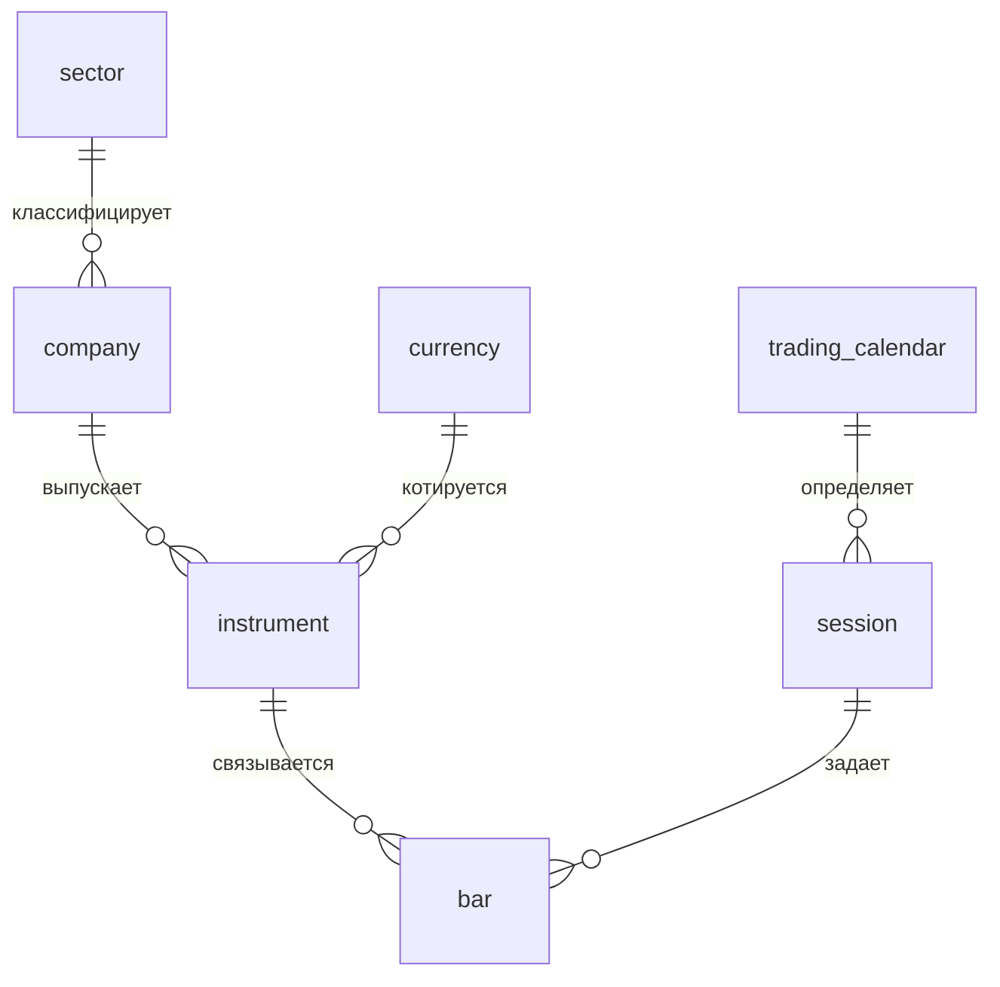
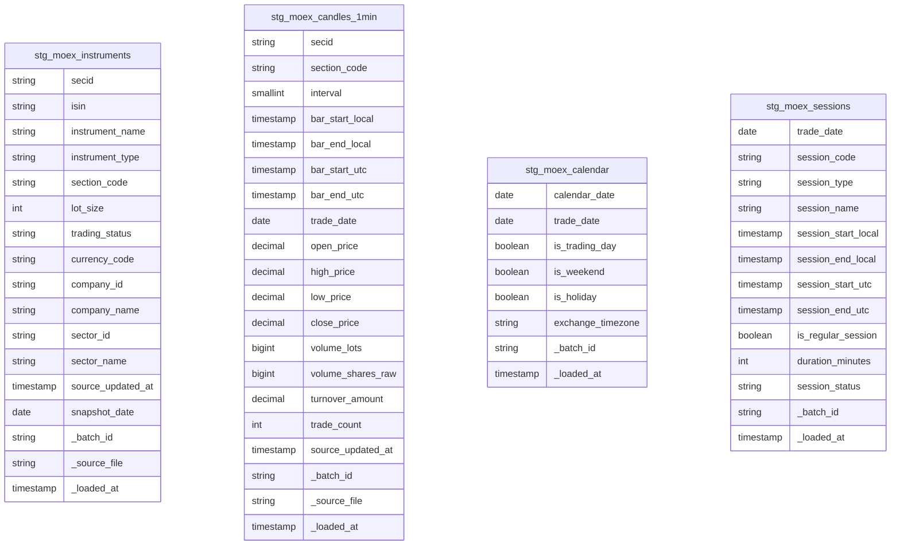
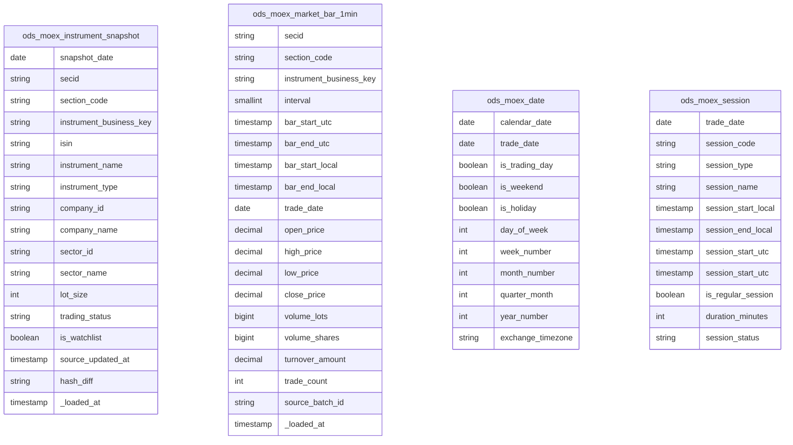
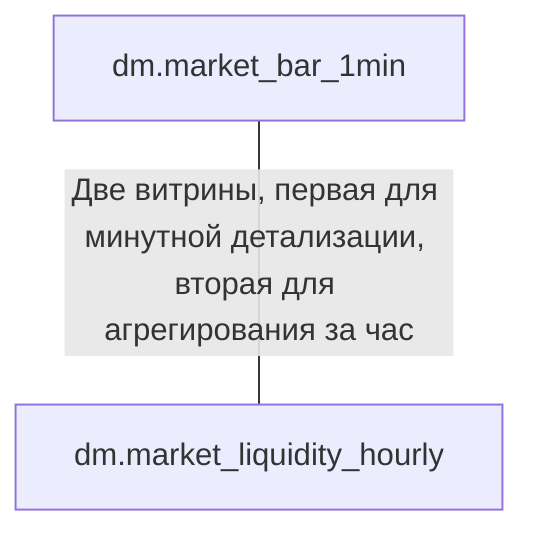
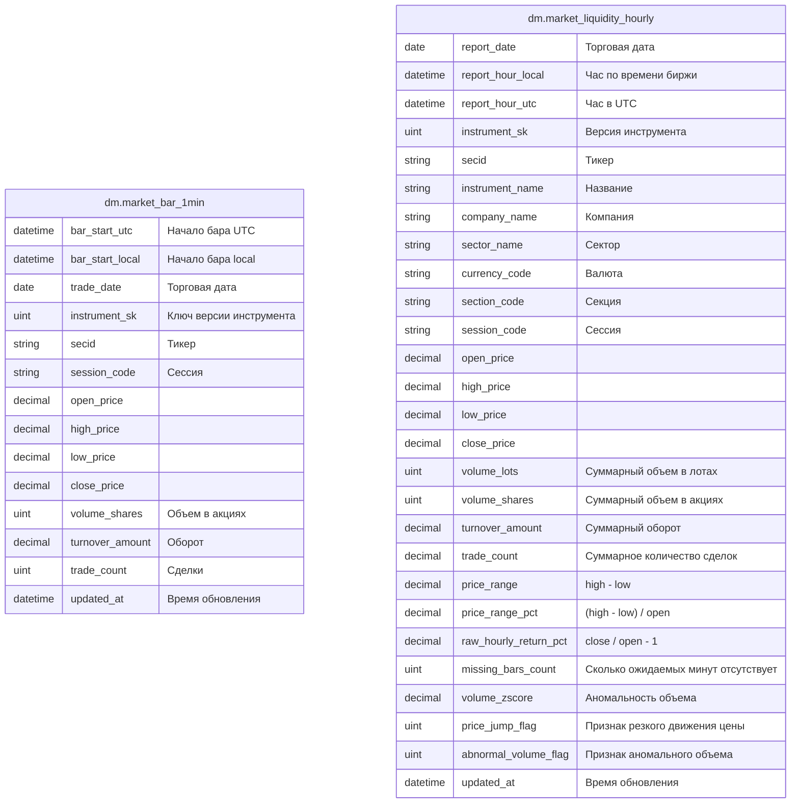
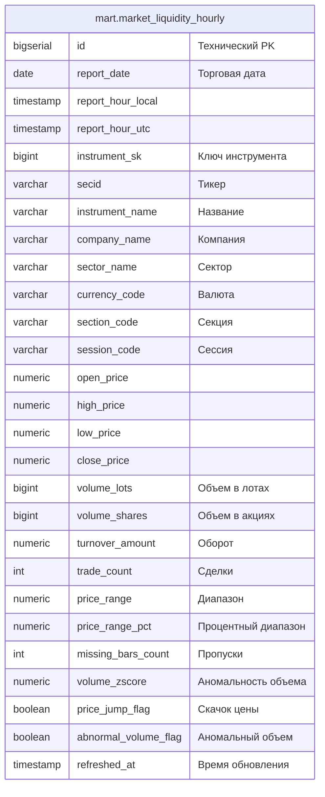
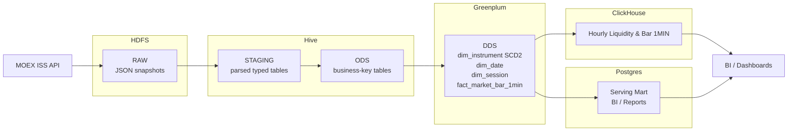

Данный README содержит отчет для задания "Методы инженерии и проектирования витрин"

## Содержание

- [Введение](#введение)
- [Бизнес-требования](#бизнес-требования)
- [Отчет](*отчет)
  - [Концептуальная модель](#концептуальная-модель)
  - [Логическая модель](#логическая-модель)
  - [Физическая модель и архитектурная схема](#физическая-модель-и-архитектура-хранилища-данных)

### Концептуальная модель

Концептуальная модель описывает предметную область рынка акций РФ. Источник данных - API ISS Московской биржи MOEX. Модель ориентирована на исторический анализ минутных баров по конкретизированному списку акций. В концептуальную модель включены следующие предмето-ориентированные сущности: сектор, компания-эмитет, валюта, инструмент, торговый календарь, торговая сессия (утро, день, вечер) и минутный бар.
Сектор классифицирует компанию - компания выпускает один или несколько инструментов - инструмент котируется в определенной валюте - торговый календарь определяет торговые дни и сессии - торговая сессия задает временные рамки, внутри которых формируются минутные бары.



Так же надо отметить, что корпоративные действия, такие как дивиденды, сплиты и консолидации исключены из набора данных, в связи с этим ценовые метрики рассчитываются по сырым, нескорректированным данным. Доходность, волатильность и сравнение цен на длинных периодах времени могут быть некорректны при наличии корпоративных событий.

**Основной бизнес-процесс -** получение и хранение минутных OHLCV-наблюдений по акциям из строгого списка. Гранулярность основного факта: один минутный бар для одного инструмента в одной торговой сессии (бар + инструмент + торговая сессия)

### Логическая модель

Выбор гранулярности трактуется из концептуальной модели выше - один минутный бар для одного инструмента в одной торговой сессии (бар + инструмент + торговая сессия). Построение витрины для быстрого согласованного результата будем производить по Кимбаллу. Начнем с таблицы фактов и вокруг неё таблицы измерений - звезда.

Определим таблицу фактов и её атрибуты:

**FACT_MARKET_BAR_1MIN:**

| Атрибут         | Тип       | Ключ        | Описание                                |
| --------------- | --------- | ----------- | --------------------------------------- |
| bar_sk          | bigint    | PK          | Суррогатный ключ строки факта           |
| instrument_sk   | bigint    | FK          | Версия инструмента                      |
| session_sk      | bigint    | FK          | Торговая сессия                         |
| date_sk         | bigint    | FK          | Дата бара                               |
| bar_start_utc   | timestamp | Бизнес ключ | Начало бара в UTC                       |
| bar_end_utc     | timestamp |             | Конец бара в UTC                        |
| bar_start_local | timestamp |             | Начало бара по времени биржи            |
| bar_end_local   | timestamp |             | Конец бара по времени биржи             |
| trade_date      | date      |             | Торговая дата                           |
| open_price      | decimal   |             | Цена открытия                           |
| high_price      | decimal   |             | Наивысшая цена                          |
| low_price       | decimal   |             | Наименьшая цена                         |
| close_price     | decimal   |             | Цена закрытия                           |
| volume_lots     | bigint    |             | Объем лотов                             |
| volume_shares   | bigint    |             | Объем в акциях (`volume_lots*lot_size`) |
| turnover_amount | decimal   |             | Оборот в валюте                         |
| trade_count     | bigint    |             | Количество сделок                       |
| source_batch_id | string    |             | Индентификатор пакета загрузки          |
| loaded_at       | timestamp |             | Время загрузки                          |

Далее определим таблицы измерений и справочники, по концептуальной модели выше:

**DIM_SECTOR (справочник секторов/отраслей компании):**

| Атрибут     | Тип     | Ключ | Описание                     |
| ----------- | ------- | ---- | ---------------------------- |
| sector_id   | string  | PK   | Индентификатор сектора       |
| sector_name | string  |      | Название сектора             |
| active_from | date    |      | Дата начала действия         |
| active_to   | date    |      | Дата конца действия          |
| is_current  | boolean |      | Признак актуальности сектора |

**DIM_COMPANY (справочник компаний-эмитетов):**

| Атрибут      | Тип     | Ключ     | Описание                      |
| ------------ | ------- | -------- | ----------------------------- |
| company_id   | string  | PK       | Индентификатор компании       |
| company_name | string  |          | Название компании             |
| sector_id    | string  | FK       | Ссылка на сектор              |
| inn          | string  | optional | ИНН компании                  |
| issuer_code  | string  | optional | Код эмитета                   |
| active_from  | date    |          | Начало действии записи        |
| active_to    | date    |          | Конец действия записи         |
| is_current   | boolean |          | Признак актуальности компании |

Инн компании представлен для отчетности, биржа не отдает его по API, поэтому возможна реализация через API КонтурФокус.

**DIM_CURRENCY (справочник валют):**

| Атрибут       | Тип    | Ключ | Описание                   |
| ------------- | ------ | ---- | -------------------------- |
| currency_code | string | PK   | Бизнес-ключ кода (RUB)     |
| currency_name | string |      | Название валюты            |
| symbol        | string |      | Символ валюты              |
| minor_unit    | int    |      | Количество минорный единиц |

На Московской бирже в основном RUB, так что справочник исключительно для корректности модели. В дальнейшем возможно интеграция с СПБ-биржей, где раньше были представлены акции иностранных компаний.

**DIM_INSTRUMENT (главное историческое измерение):**

| Атрибут                 | Тип       | Ключ        | Описание                                           |
| ----------------------- | --------- | ----------- | -------------------------------------------------- |
| instrument_sk           | bigint    | PK          | Суррогатный ключ версии инструмента                |
| instrument_business_key | string    | natural key | Бизнес-ключ                                        |
| secid                   | string    | source key  | Тикер бумаги MOEX                                  |
| isin                    | string    | optional    | Международный идентификатор                        |
| instrument_name         | string    |             | Название инструмента                               |
| instrument_type         | string    |             | Тип, например common_share / preferred_share       |
| company_id              | string    | FK          | Компания-эмитент                                   |
| currency_code           | string    | FK          | Валюта котирования                                 |
| sector_id               | string    | FK          | Сектор на момент версии                            |
| section_code            | string    |             | Торговая секция, например TQBR                     |
| lot_size                | int       |             | Размер лота                                        |
| trading_status          | string    |             | Статус торгов                                      |
| is_watchlist            | boolean   |             | Признак включения в список отслеживаемых           |
| valid_from              | timestamp |             | Начало действия версии                             |
| valid_to                | timestamp |             | Конец действия версии                              |
| is_current              | boolean   |             | Признак текущей версии                             |
| hash_diff               | string    |             | Хэш изменяемых атрибутов для обнаружения изменений |
| source_updated_at       | timestamp |             | Время обновления в источнике                       |
| loaded_at               | timestamp |             | Время загрузки в DWH                               |

Самая большая таблица измерений, хранит:

- бизнес-индентичность акций;
- торговые параметры;
- исторические версии параметров;
- связь с компанией, валютой и сектором.

Бизнес-ключ intrument*business_key должен быть достаточно устойчив, поэтому будет формироваться из `secid+'*'+section_code`.
Обозначим события, при которых будут происходить исторические изменения:

- intrument_name: название бумаги может поменяться
- company_id: изменении привязки к эмитету, причина реорганизация или исправления справочника
- sector_id: сектор может быть изменен
- section_code: инструмент может перейти в другую секцию
- lot_size: изменение размера лота
- trading_status: изменение статуса торгов
- is_watchlist: исключение из состава отслеживаемых

**DIM_DATE (торговый календарь):**

| Атрибут           | Тип     | Ключ        | Описание                                       |
| ----------------- | ------- | ----------- | ---------------------------------------------- |
| date_sk           | int     | PK          | Суррогатный ключ даты                          |
| calendar_date     | date    | natural key | Календарная дата                               |
| trade_date        | date    |             | Торговая дата, может совпадать с calendar_date |
| is_trading_day    | boolean |             | Признак торгового дня                          |
| is_weekend        | boolean |             | Признак выходного                              |
| is_holiday        | boolean |             | Признак праздника                              |
| day_of_week       | int     |             | День недели                                    |
| week_number       | int     |             | Номер недели                                   |
| month_number      | int     |             | Номер месяца                                   |
| quarter_number    | int     |             | Номер квартала                                 |
| year_number       | int     |             | Год                                            |
| exchange_timezone | string  |             | Europe/Moscow                                  |
| session_count     | int     | optional    | Количество сессий за день                      |

**DIM_SESSION (торговая сессия):**

| Атрибут             | Тип       | Ключ             | Описание                             |
| ------------------- | --------- | ---------------- | ------------------------------------ |
| session_sk          | bigint    | PK               | Суррогатный ключ сессии              |
| date_sk             | int       | FK               | Дата сессии                          |
| session_code        | string    | natural key part | Код сессии                           |
| session_type        | string    |                  | Тип сессии                           |
| session_name        | string    |                  | Название сессии                      |
| session_start_local | timestamp |                  | Начало по времени биржи              |
| session_end_local   | timestamp |                  | Конец по времени биржи               |
| session_start_utc   | timestamp |                  | Начало в UTC                         |
| session_end_utc     | timestamp |                  | Конец в UTC                          |
| is_regular_session  | boolean   |                  | Признак основной сессии              |
| duration_minutes    | int       |                  | Длительность в минутах               |
| session_status      | string    |                  | scheduled / active / closed / halted |
| loaded_at           | timestamp |                  | Время загрузки                       |


### Физическая модель и архитектура хранилища данных

**Хранилища**:
HDFS - RAW
Hive - Staging
Hive - ODS
Greenplum - DDS
Clickhouse - Data Mart
Postgres Serving - Mart

Зафиксируем вывод из шагов выше, эти ограничения послужат для проектирования физической модели:

- Источник - ISS API MOEX
- Scope - список около 100 ликвидных акций РФ
- Основной интервал - 1 мин.
- Торговая секция считается фиксированной и принимается как TQBR
- Историчность торговых параметров инструмента обеспечивается через dim_instrument посредством SCD 2
- Все ценовые метрики являются raw / неаддитивными
- Факт содержит только фактически полученные бары
- Время хранится в UTC и в локальном времени биржи MSK
- Торговая дата может отличаться от календарной даты для вечерних сессий и клиринговых переходов

Общее физическое представление:

| Слой           | Система    | Физические объекты                                 | Назначение                                                             |
| -------------- | ---------- | -------------------------------------------------- | ---------------------------------------------------------------------- |
| RAW            | HDFS       | JSON-файлы ответов MOEX ISS                        | Сохранить сырой источник без изменений                                 |
| STAGING        | Hive       | `stg_moex_*`                                       | Развернуть JSON, привести типы, выполнить первичную валидацию          |
| ODS            | Hive       | `ods_moex_*`                                       | Нормализованные данные, близкие к источнику, с бизнес-ключами          |
| DDS            | Greenplum  | `dds.dim_*`, `dds.fact_market_bar_1min`            | Размерная модель, SCD2, конформированные измерения, аналитический факт |
| Data Mart OLAP | ClickHouse | `dm.market_liquidity_hourly`, `dm.market_bar_1min` | Быстрые time-series агрегации, аномалии, часовая витрина               |
| Serving Mart   | Postgres   | `mart.market_liquidity_hourly`                     | Стабильный слой для BI, отчетов и дашбордов                            |

1. **RAW-слой** - здесь будут храниться сырые данные, которые пришли с API биржи. Примерная структура путей:

```txt
/data/raw/moex/instrument/dt=YYYY-MM-DD/batch_id=.../part-*.json
/data/raw/moex/candles/interval=1/dt=YYYY-MM-DD/batch_id=.../part-*.json
```

Метаданные для слоя в манифест-файлах:

- batch_id - индентификатор пакета загрузки
- source_system - MOEX_ISS
- endpoint - ручка к которой обращаемся для получения результатов
- request_url - URL запроса
- http_status - код ответа
- loaded_at - время загрузки в HDFS
- file_path - путь к файлу
- row_count - количество записей
- checksum - контрольная сумма файла

2.  **Staging-слой** - здесь JSON разворачивается в колонки, приводятся типы, добавляются технические поля.
    Основные таблицы партиционируются по дате, для свечей дополнительно по интервалу

Схема staging-слоя:



3. ODS-слой, близкий к источнику, но уже очищенный, типизированный и пригодный для загрузки в DWH. В ODS будут использоваться бизнес-ключи, суррогатные добавим на слое DDS. ODS хранит снимок, а не историю.

Схема ODS-слоя:



4. Greenplum DDS-слой, ядро хранилища, добавляем суррогатные ключи и храним историю посредством SCD2:


5. ClickHouse Data Mart - используется как аналитический OLAP-слой для часовой витрины ликвидности и аномалий.





6. Postgres Serving Mart - используется как стабильный слой для BI, отчетов и пользовательских дашбордов, на нем будет только часовой отчет:



**Архитектура движения данных:**



Архитектура хранилища данных построена на 5 слоях источник -> RAW -> STAGING -> ODS -> DDS -> MARTS -> дашборды.

- Источник данных включает справочники инструментов, минутные бары (candles), торговый календарь и торговые сессии;
- Сырые ответы сохраняются в HDFS Raw в формате JSON без изменений, слоя является неизменяемым и обеспечивает воспроизводить ETL, аудит источника и возможность повторной обработки при изменении правил парсинга и валидации, хранение метаданных;
- Данные поступают в Hive Staging, где выполняется парсинг JSON, приведение типов, название полей, добавление технических атрибутов батча и загрузки, также первичная проверка качества: выявляются дубликаты, некорректные значения, пропуски обязательных полей и записи, не попадающие в торговые сессии, если такие имеются;
- Следом данные попадают в Hive ODS, прослойка уже имеет очищенные данные для загрузки в хранилище, но пока что сущности используют бизнес-ключи;
- Ядро хранилища реализуется в Greenplum DDS. Здесь строится звезда. Генерируются суррогатные ключи, имеет историчность, гранулярность - "один инструмент за одну минуту торговой сессии";
- ClickHouse - OLAP Data Mart для минутных баров и часовой витрины ликвидности. ClickHouse - колоночное хранение, эффективные агрегации по временным диапазонам и способность быстро обслуживать аналитические запросы по большим объемам минутных данных;
- Postgres Serving Mart - для BI и отчетности. В нем хранятся агрегированная витрина mart.market_liquidity_hourly. Главная цель предоставить стабильный и совместимый с BI-инструментами интерфейс доступа к готовым аналитическим данным.
