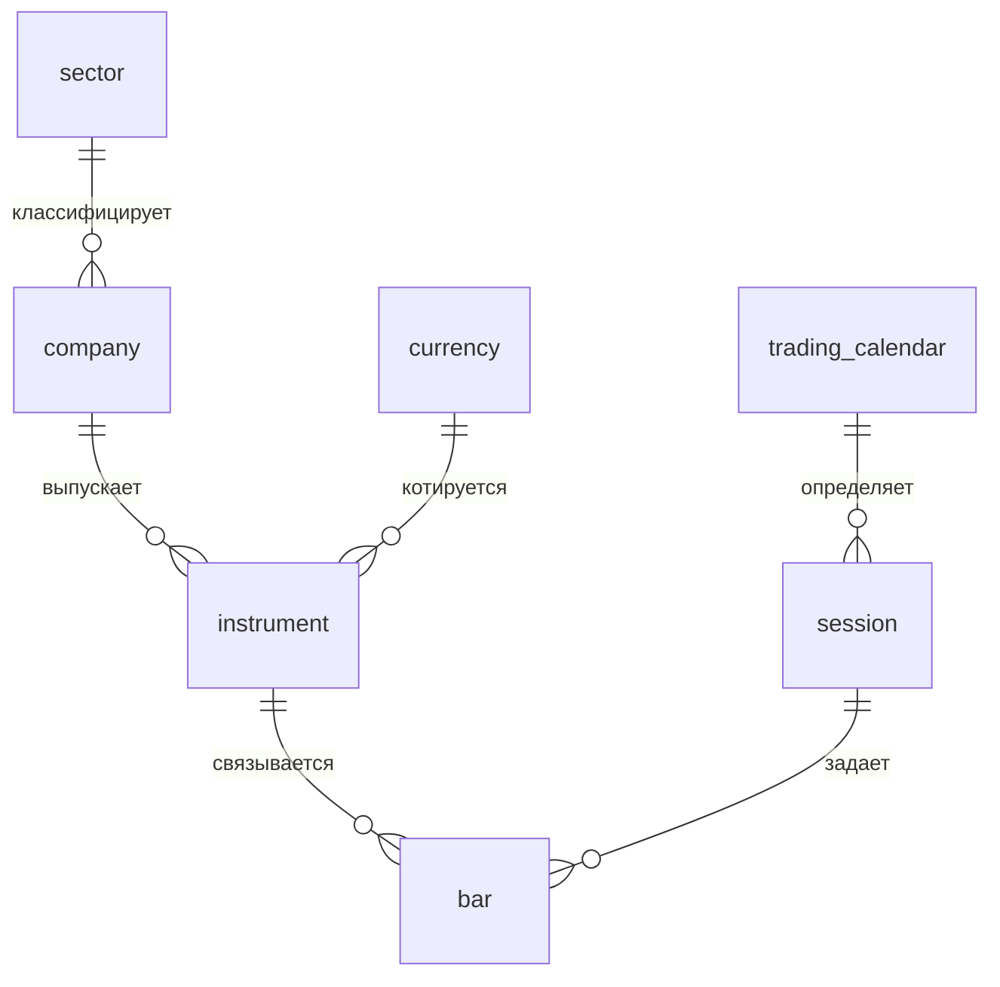
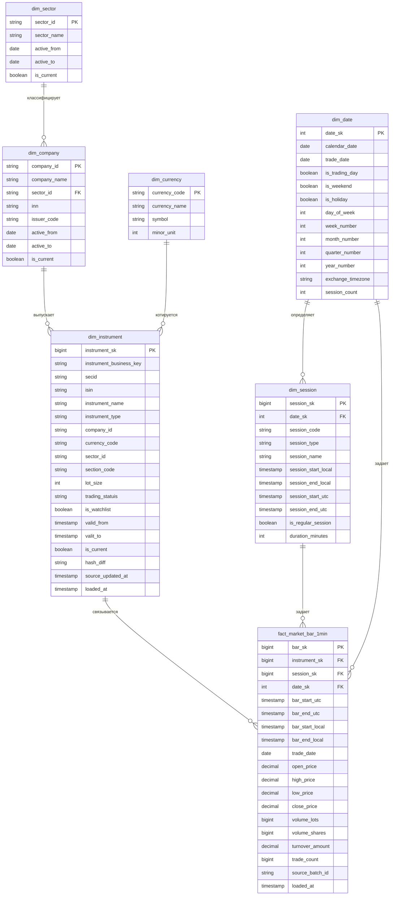

# methodDWH

## Концептуальная модель

Концептуальная модель описывает предметную область рынка акций РФ. Источник данных - API ISS Московской биржи MOEX. Модель ориентирована на исторический анализ минутных баров по конкретизированному списку акций. В концептуальную модель включены следующие предмето-ориентированные сущности: сектор, компания-эмитет, валюта, инструмент, торговый календарь, торговая сессия (утро, день, вечер) и минутный бар.
Сектор классифицирует компанию - компания выпускает один или несколько инструментов - инструмент котируется в определенной валюте - торговый календарь определяет торговые дни и сессии - торговая сессия задает временные рамки, внутри которых формируются минутные бары.

Так же надо отметить, что корпоративные действия, такие как дивиденды, сплиты и консолидации исключены из набора данных, в связи с этим ценовые метрики рассчитываются по сырым, нескорректированным данным. Доходность, волатильность и сравнение цен на длинных периодах времени могут быть некорректны при наличии корпоративных событий.

**Основной бизнес-процесс -** получение и хранение минутных OHLCV-наблюдений по акциям из строгого списка. Гранулярность основного факта: один минутный бар для одного инструмента в одной торговой сессии (бар + инструмент + торговая сессия)

## Логическая модель
- [ ] ERD-диаграмма
- [ ] Описание сущностей, атрибутов и связей
- [ ] Выбор гранулярности факта

Выбор гранулярности трактуется из концептуальной модели выше - один минутный бар для одного инструмента в одной торговой сессии (бар + инструмент + торговая сессия). Построение витрины для быстрого согласованного результата будем производить по Кимбаллу. Начнем с таблицы фактов и вокруг неё таблицы измерений - звезда.

Определим таблицу фактов и её атрибуты:

**FACT_MARKET_BAR_1MIN:**

| Атрибут         | Тип       | Ключ        | Описание                                |
| --------------- | --------- | ----------- | --------------------------------------- |
| bar_sk          | bigint    | PK          | Суррогатный ключ строки факта           |
| instrument_sk   | bigint    | FK          | Версия инструмента                      |
| session_sk      | bigint    | FK          | Торговая сессия                         |
| date_sk         | bigint    | FK          | Дата бара                               |
| bar_start_utc   | timestamp | Бизнес ключ | Начало бара в UTC                       |
| bar_end_utc     | timestamp |             | Конец бара в UTC                        |
| bar_start_local | timestamp |             | Начало бара по времени биржи            |
| bar_end_local   | timestamp |             | Конец бара по времени биржи             |
| trade_date      | date      |             | Торговая дата                           |
| open_price      | decimal   |             | Цена открытия                           |
| high_price      | decimal   |             | Наивысшая цена                          |
| low_price       | decimal   |             | Наименьшая цена                         |
| close_price     | decimal   |             | Цена закрытия                           |
| volume_lots     | bigint    |             | Объем лотов                             |
| volume_shares   | bigint    |             | Объем в акциях (`volume_lots*lot_size`) |
| turnover_amount | decimal   |             | Оборот в валюте                         |
| trade_count     | bigint    |             | Количество сделок                       |
| source_batch_id | string    |             | Индентификатор пакета загрузки          |
| loaded_at       | timestamp |             | Время загрузки                          |
Далее определим таблицы измерений и справочники, по концептуальной модели выше:

**DIM_SECTOR (справочник секторов/отраслей компании):**

| Атрибут     | Тип     | Ключ | Описание                     |
| ----------- | ------- | ---- | ---------------------------- |
| sector_id   | string  | PK   | Индентификатор сектора       |
| sector_name | string  |      | Название сектора             |
| active_from | date    |      | Дата начала действия         |
| active_to   | date    |      | Дата конца действия          |
| is_current  | boolean |      | Признак актуальности сектора |
**DIM_COMPANY (справочник компаний-эмитетов):**

| Атрибут      | Тип     | Ключ     | Описание                      |
| ------------ | ------- | -------- | ----------------------------- |
| company_id   | string  | PK       | Индентификатор компании       |
| company_name | string  |          | Название компании             |
| sector_id    | string  | FK       | Ссылка на сектор              |
| inn          | string  | optional | ИНН компании                  |
| issuer_code  | string  | optional | Код эмитета                   |
| active_from  | date    |          | Начало действии записи        |
| active_to    | date    |          | Конец действия записи         |
| is_current   | boolean |          | Признак актуальности компании |
Инн компании представлен для отчетности, биржа не отдает его по API, поэтому возможна реализация через API КонтурФокус.

**DIM_CURRENCY (справочник валют):**

| Атрибут       | Тип    | Ключ | Описание                   |
| ------------- | ------ | ---- | -------------------------- |
| currency_code | string | PK   | Бизнес-ключ кода (RUB)     |
| currency_name | string |      | Название валюты            |
| symbol        | string |      | Символ валюты              |
| minor_unit    | int    |      | Количество минорный единиц |
На Московской бирже в основном RUB, так что справочник исключительно для корректности модели. В дальнейшем возможно интеграция с СПБ-биржей, где раньше были представлены акции иностранных компаний.

**DIM_INSTRUMENT (главное историческое измерение):**

| Атрибут                 | Тип       | Ключ        | Описание                                           |
| ----------------------- | --------- | ----------- | -------------------------------------------------- |
| instrument_sk           | bigint    | PK          | Суррогатный ключ версии инструмента                |
| instrument_business_key | string    | natural key | Бизнес-ключ                                        |
| secid                   | string    | source key  | Тикер  бумаги MOEX                                 |
| isin                    | string    | optional    | Международный идентификатор                        |
| instrument_name         | string    |             | Название инструмента                               |
| instrument_type         | string    |             | Тип, например common_share / preferred_share       |
| company_id              | string    | FK          | Компания-эмитент                                   |
| currency_code           | string    | FK          | Валюта котирования                                 |
| sector_id               | string    | FK          | Сектор на момент версии                            |
| section_code            | string    |             | Торговая секция, например TQBR                     |
| lot_size                | int       |             | Размер лота                                        |
| trading_status          | string    |             | Статус торгов                                      |
| is_watchlist            | boolean   |             | Признак включения в список отслеживаемых           |
| valid_from              | timestamp |             | Начало действия версии                             |
| valid_to                | timestamp |             | Конец действия версии                              |
| is_current              | boolean   |             | Признак текущей версии                             |
| hash_diff               | string    |             | Хэш изменяемых атрибутов для обнаружения изменений |
| source_updated_at       | timestamp |             | Время обновления в источнике                       |
| loaded_at               | timestamp |             | Время загрузки в DWH                               |
Самая большая таблица измерений, хранит:
 - бизнес-индентичность акций;
 - торговые параметры;
 - исторические версии параметров;
 - связь с компанией, валютой и сектором.

Бизнес-ключ intrument_business_key должен быть достаточно устойчив, поэтому будет формироваться из `secid+'_'+section_code`.
Обозначим события, при которых будут происходить исторические изменения:
- intrument_name: название бумаги может поменяться
- company_id: изменении привязки к эмитету, причина реорганизация или исправления справочника
- sector_id: сектор может быть изменен
- section_code: инструмент может перейти в другую секцию
- lot_size: изменение размера лота
- trading_status: изменение статуса торгов
- is_watchlist: исключение из состава отслеживаемых

**DIM_DATE (торговый календарь):**

| Атрибут           | Тип     | Ключ        | Описание                                       |
| ----------------- | ------- | ----------- | ---------------------------------------------- |
| date_sk           | int     | PK          | Суррогатный ключ даты                          |
| calendar_date     | date    | natural key | Календарная дата                               |
| trade_date        | date    |             | Торговая дата, может совпадать с calendar_date |
| is_trading_day    | boolean |             | Признак торгового дня                          |
| is_weekend        | boolean |             | Признак выходного                              |
| is_holiday        | boolean |             | Признак праздника                              |
| day_of_week       | int     |             | День недели                                    |
| week_number       | int     |             | Номер недели                                   |
| month_number      | int     |             | Номер месяца                                   |
| quarter_number    | int     |             | Номер квартала                                 |
| year_number       | int     |             | Год                                            |
| exchange_timezone | string  |             | Europe/Moscow                                  |
| session_count     | int     | optional    | Количество сессий за день                      |

DIM_SESSION (торговая сессия):

| Атрибут             | Тип       | Ключ             | Описание                |
| ------------------- | --------- | ---------------- | ----------------------- |
| session_sk          | bigint    | PK               | Суррогатный ключ сессии |
| date_sk             | int       | FK               | Дата сессии             |
| session_code        | string    | natural key part | Код сессии              |
| session_type        | string    |                  | Тип сессии              |
| session_name        | string    |                  | Название сессии         |
| session_start_local | timestamp |                  | Начало по времени биржи |
| session_end_local   | timestamp |                  | Конец по времени биржи  |
| session_start_utc   | timestamp |                  | Начало в UTC            |
| session_end_utc     | timestamp |                  | Конец в UTC             |
| is_regular_session  | boolean   |                  | Признак основной сессии |
| duration_minutes    | int       |                  | Длительность в минутах  |

## Физическая модель